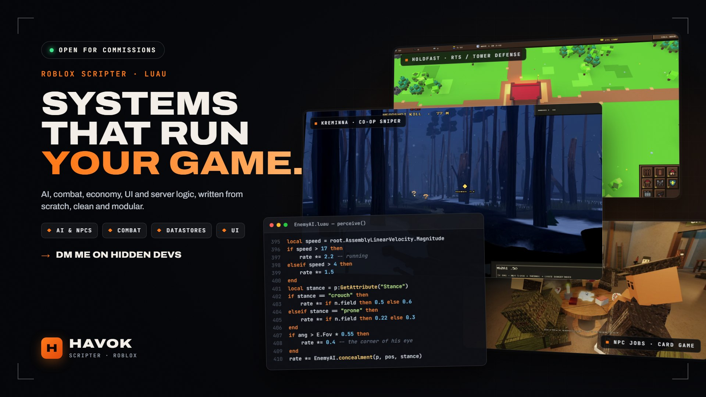
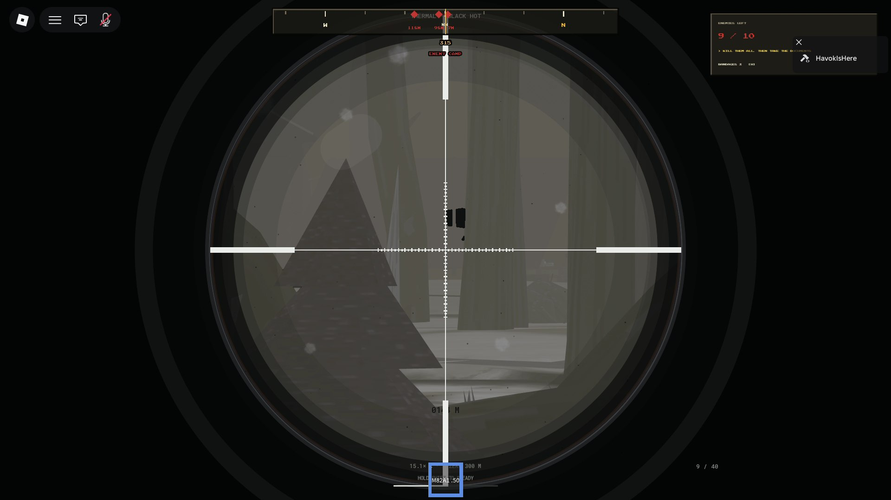
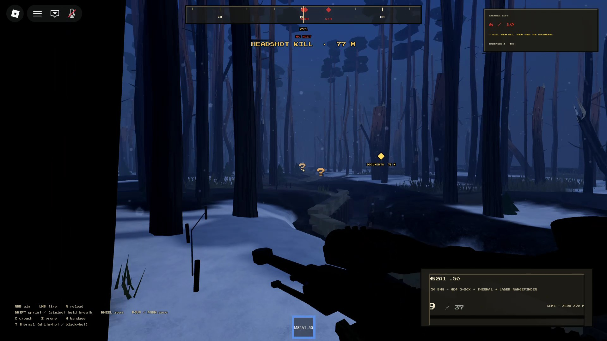
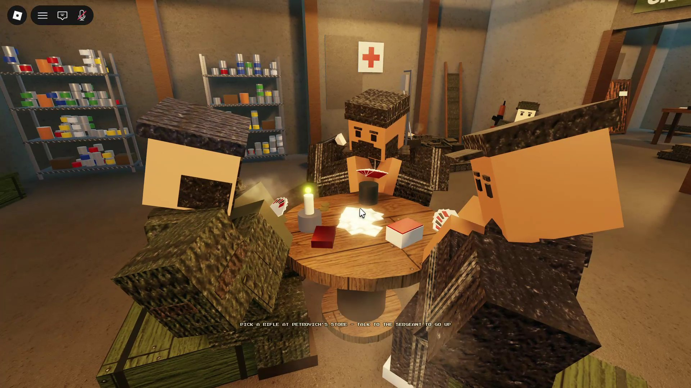
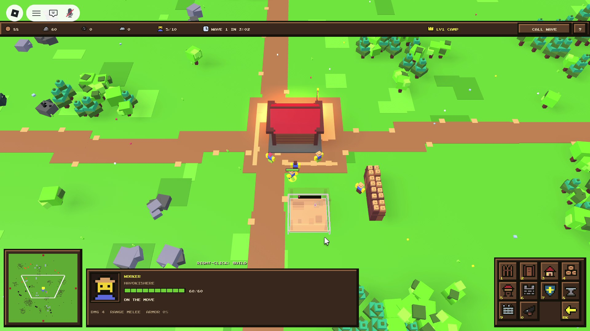

# Havok — Roblox Scripting Portfolio

Code samples from two of my Roblox games, written in Luau. These are a selection of modules, not the full games, so each file `require`s things (Config, Grid, Theme…) that aren't in this repo.

---

## KREMINNA — co-op sniper game

About 25,000 lines across 65 modules: a lobby place, two mission places, squad teleports, a persistent economy and server-side enemy AI.

| | |
|---|---|
|  |  |

| File | What it shows |
|---|---|
| [`server/EnemyAI.luau`](kreminna/server/EnemyAI.luau) | A 10 Hz server-side AI with states (Patrol → Alert → Draw → Aim → Search → Ready). Perception covers view cone, line of sight, distance, movement speed, stance and concealment, plus hearing near-misses and squad deaths. State is published as attributes, so clients animate it with no extra remotes. |
| [`server/Profile.luau`](kreminna/server/Profile.luau) | DataStore profiles: money, owned rifles, ammo per calibre, items. Mission payouts are tracked by run ID, so a reward can never be credited twice. |
| [`server/Travel.luau`](kreminna/server/Travel.luau) | Teleporting a squad between places together, carrying loadouts in TeleportData, with Studio fallbacks. |
| [`client/Ballistics.luau`](kreminna/client/Ballistics.luau) | Bullets with muzzle velocity and gravity, raycast in 1/120 s sub-steps. The client reports impacts and the server validates them against the recorded shot. |
| [`client/BulletCam.luau`](kreminna/client/BulletCam.luau) | A headshot replay cam. It snapshots the target, replays the round's real flight path, and ends with a local physics ragdoll. |
| [`client/Theme.luau`](kreminna/client/Theme.luau) | A custom UI kit (body-camera style) that every screen in the game is built from: windows, buttons, bars, captions, pop-in animation. |

*NPCs in the lobby run jobs (card game, drinking, wounded) driven by attributes. All animation is procedural (Motor6D + IK), with no uploaded animations.*

---

## HOLDFAST — RTS / tower defense

You command a squad of bots from a top-down camera: gather resources, build palisades, survive 20 raider waves. Up to 4 players co-op.

| File | What it shows |
|---|---|
| [`server/Paths.luau`](holdfast/server/Paths.luau) | Grid pathfinding: A* (binary heap) for your units, and a Dijkstra flow field for raiders where walls add a break-through cost, so raiders decide whether smashing a palisade is cheaper than walking around it. |
| [`shared/Pack.luau`](holdfast/shared/Pack.luau) | Units aren't Humanoids. The server sim sends each unit as a small packed snapshot. |
| [`client/UnitView.luau`](holdfast/client/UnitView.luau) | The client side: unpacks snapshots and drives lightweight rigs (BulkMoveTo) with interpolation and animation. |

---

## How I write code

- **Server-authoritative:** rewards, hits and purchases are validated on the server.
- **Modular:** one job per ModuleScript, tunables in a shared Config.
- **Typed Luau** where it helps, with comments explaining the *why*.

**Contact:** [Discord / Hidden Devs: fill in]
